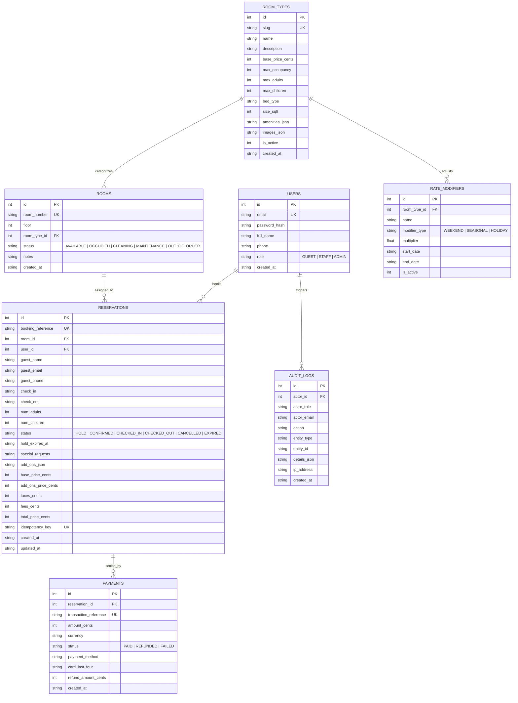

# Database Schema & Entity-Relationship Diagram

## Entity-Relationship Diagram

## Schema Design Highlights & Constraints

1. **Monetary Precision**: All prices, taxes, resort fees, and payment amounts are stored as integer cents (`*_cents`) rather than floating-point numbers to eliminate rounding errors.
2. **Foreign Key Referential Integrity**: `PRAGMA foreign_keys = ON` is enabled globally on all database connections.
3. **Check Constraints**: Enum fields (`role`, `status`, `modifier_type`, `payment.status`) and domain bounds (`base_price_cents > 0`, `floor >= 1`, `max_occupancy > 0`) are strictly enforced at the database engine level.
4. **Concurrency & Performance Indexes**:
   - `idx_reservations_room_dates` on `(room_id, check_in, check_out, status)` optimizes overlap interval scans `(check_in < search_out AND check_out > search_in)`.
   - `idx_reservations_reference` provides O(log n) lookup for booking vouchers and front desk queries.
   - `idx_audit_created` accelerates chronological audit log pagination.
5. **Idempotency**: `idempotency_key` carries a `UNIQUE` index so repeated payment submissions cannot create duplicate reservations or duplicate financial entries.
